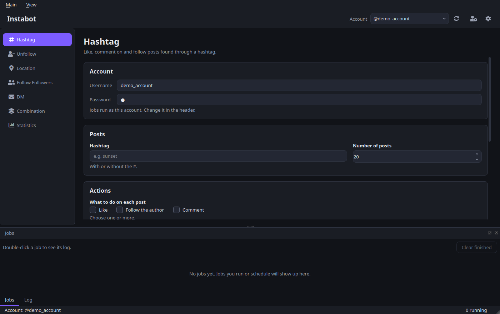

# Instabot
A desktop program that likes, follows and comments on Instagram posts, and sends direct messages, automatically, through a real Chrome window.



## How to start

You need Python 3.12 or newer and Google Chrome.

1. Clone this project: `git clone git@github.com:EranBolan91/Instabot.git`
2. `cd Instabot`
3. Create a virtual environment and install the packages:
   ```bash
   python3 -m venv .venv
   .venv/bin/pip install -r requirements.txt
   ```
4. Run it: `.venv/bin/python main.py`

The right ChromeDriver for your Chrome is downloaded automatically the first time a bot runs.

Optional: to get an e-mail with a screenshot when Instagram blocks an account, put `MAILGUN_DOMAIN` and `MAILGUN_API` in a `.env` file.

## Using it
1. **Main → Accounts:** add your Instagram account (username and password, saved in a local SQLite file, `instabot.db`).
2. Pick the account in the header.
3. Choose a page in the sidebar, fill the form and click Run. Each run becomes a **job** with its own Chrome window. You can run it now or schedule it for later.
4. The **Jobs** tab at the bottom shows every job; you can stop a running one. The **Log** tab shows what the bots are doing.

If Instagram asks for a security check, log in to that account by hand once, then run again.

## What the program can do
1. **Hashtag:** like / comment on / follow the posts of a hashtag.
2. **Location:** the same, for the posts of a location page.
3. **Follow Followers:** follow the followers of another profile, or the accounts it follows.
4. **Unfollow:** see who doesn't follow you back, and unfollow the users the bot followed (all of them, only those who don't follow back, or everyone).
5. **DM:** send a message to the users in a distribution list.
6. **Combination:** follow users who liked a post, about 100 over 12 hours, then unfollow them all, and repeat.
7. **Statistics:** the results of past runs.

Comments are written as a comma-separated list, and the bot picks one at random for each post.

### Settings
- Only follow users with at least X followers / X posts.
- **Distribution lists:** groups of users, filled while following, used as DM recipients.
- **Warm-up websites:** the bot visits one of them before logging in.
- Proxies can be saved, but the bots don't use them yet.

### Inspect Settings
Instagram changes its pages often. Everything the bots look for on a page (buttons, fields, lists) is in `utils/instagram_selectors.json`. **Main → Inspect Settings** lets you edit it, and **Check selectors** logs in and tests every one of them on real Instagram without clicking anything that changes your account.

## For developers
- `PROJECT_OVERVIEW.md` explains every module, class and database table.
- Tests: `.venv/bin/pip install -r requirements-dev.txt`, then `.venv/bin/python -m pytest`.

Automating Instagram is against Instagram's Terms of Use and can get an account restricted. Use it on accounts you own, at your own risk.
